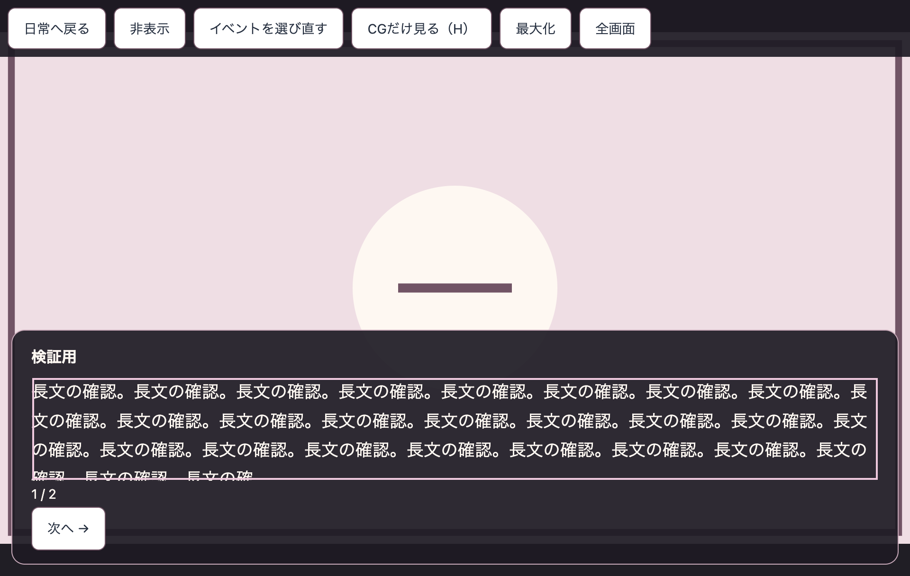
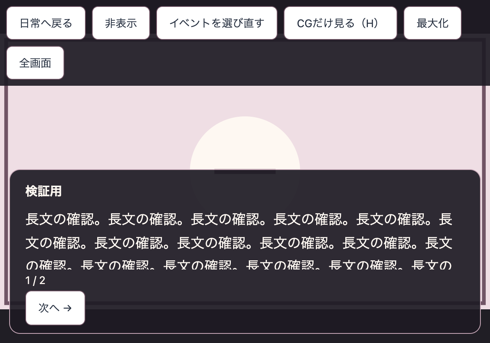
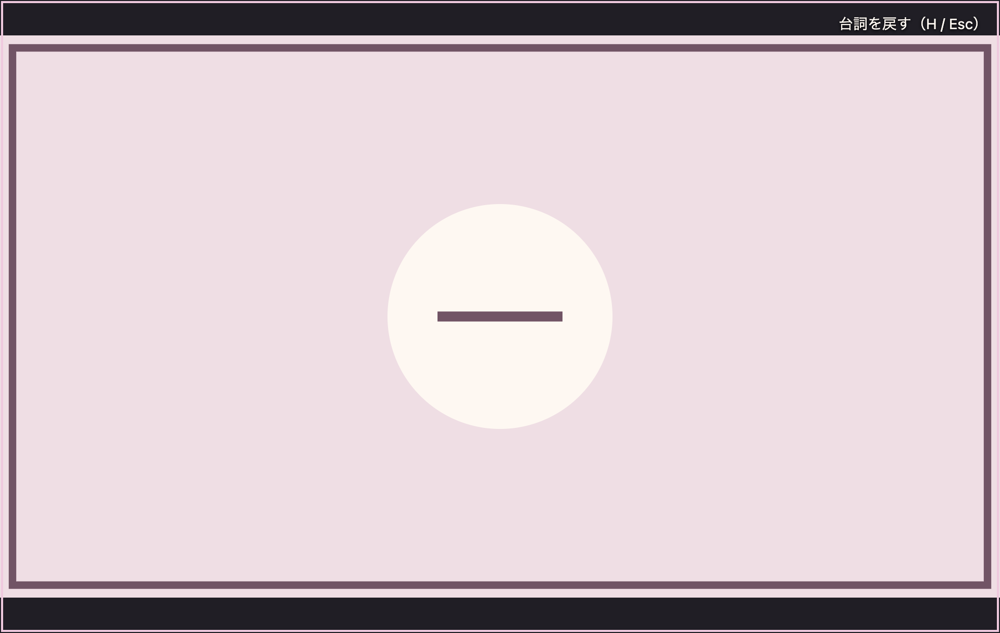

# Issue #44 CGフォーカス表示

## 実装範囲と設計判断

D1のA案（左画像・右本文）は `standard` として維持する。#44はユーザーの後続承認によるCGノード限定の追加仕様。`cg_focus` では矩形のイベント窓全体へCGをcontain表示し、下部に暗い半透明（92%）の台詞パネルを重ねる。本文18 DIP、クリーム色の文字・桜色の枠を使用。画像のトリミングや加工、成人向け素材・台本、#32/#33の機能は追加しない。新規依存なし。

640×480 DIPではツールを折り返し、台詞・選択肢パネル全体を高さ48%以内でスクロールする。16:9、4:3、縦長は同じcontain領域を使用。CG差分は既存asset ID切替を利用し、CG間のフェードは無効化して明滅を抑える。未登録ID/デコード失敗はstandardへ戻し、エラー文と本文・選択肢・退出を提供する。

## 操作

- 「CGだけ見る」またはHで台詞と補助UIを隠す。画面全体が「台詞を戻す」ボタンになり、クリック/H/Escで復元。復元操作では台詞を進めない。非表示の本文・選択肢はTab順序からも外れる。
- Escは鑑賞解除→全画面解除→日常へ戻るの優先順。専用画面の既存Escリスナーと二重実行しないよう、イベントビューのcaptureリスナーが処理する。OSの閉じる・非表示・スリープは鑑賞状態に関係なく退出する。
- 最大化/解除、全画面/解除は明示ボタン（Tab→Enter/Spaceでも操作可能）。F11も全画面を切り替える。macOSではキーボード設定によりFnが必要。起動・再開時に自動で最大化/全画面へ入らない。
- macOSはSpaces遷移中のhideで既存退出処理が動くため、setSimpleFullScreen（Spacesを作らない全画面）を使用する。WindowsはsetFullScreenと非同期通知を使用。blur/hideの安全条件は緩めない。Mainの専用コントローラーがWindowsの非同期全画面通知を待つ。全画面解除で入場直前の通常boundsと最大化状態を復元。座標はDIP、画面取り外し時は現在の作業領域へ補正。ネイティブOS操作による全画面切替も通知に追従する。

## #31向けデータ例

既存ノードへ任意の `presentation` を追加する。未指定はstandard。未知値、CG IDがnullのcg_focusをスキーマで拒否する。画像ID自体の未登録・デコード失敗はRendererで安全にフォールバックする。

```json
{
  "id": "still",
  "speaker": "小春",
  "text": "採用済み台本の本文を配置する",
  "expression": "smile",
  "effect": "none",
  "cgAssetId": "approved-still-id",
  "presentation": "cg_focus",
  "next": "after-still",
  "choices": [],
  "end": false
}
```

`approved-still-id` は例示であり実登録しない。#31が承認済みCGを受領後に適切な専用ロード経路へ登録する。同一構図の差分は次ノードで別asset IDを指定し、通常会話に戻るノードはpresentationを省略する。一般サンプルの「お茶」分岐でstandard→cg_focus→standardを確認できる。

## 保存とプライバシー

EventPlayerのrevision、ページ・選択・訪問記録・チェックポイント、MemoryStoreを再利用。表示方式は現在ノードから毎回導出し、セーブスキーマを変更しない。UI非表示・全画面状態・成人確認は保存しない。再起動は日常のみ、一覧の「続きから」で表示方式を復元する。

限定IPC `events:window` はget/maximize/fullscreen/restoreのみ。既存のeventTargetで当該ウィンドウのmainFrameを確認し、専用では確認前に拒否。変更時はフォーカスも確認。Rendererに任意bounds・パス・Node権限を渡さない。

#29のblur ONは即時破棄、OFFは進行休止・明示再開。UI非表示中の休止/保存エラーではUIを復元する。スリープ・終了・再起動の許可失効、日常の元表示・停止状態、親密度/交流回数の非加算は既存処理を維持する。専用CGや専用イベントは製品カタログへ追加しない。OSプレビュー/画面収録への完全な保護は保証しない。

## 自動検証

- `npm run check`: ESLint/Prettier、単体88件、型チェック、ビルド成功。
- `npm run test:events`: 既存3プロセス＋CG追加2プロセス成功。通常→CG→通常、最大化/解除、最大化から全画面に入って元状態へ復元、F11/Esc、鑑賞ボタン/H/復元クリック、18 DIP本文、160文字超の長文、8個の複数行選択肢、16:9/差分/4:3/縦長、未登録/デコード失敗、途中保存・別プロセスで明示再開、blur休止・明示再開、専用全画面鑑賞中のblur ON/OFF・スリープ・OS close、非加算を確認。
- `npm run test:private-mode`: 既存3プロセス（編集/再起動/破損復旧）成功。確認・専用/一般分離・通常復帰を維持。
- `npm run test:smoke`: 透明部/実画素入力、IPC、トレイ、復旧成功。
- `npm run test:settings`: 実UI、停止・非表示、サイズ、衣装、設定保存・再起動成功。
- `npm run test:memory`, `npm run test:character`, `npm run test:styles`: 保存/初期化、実PNG/衣装/アルファ判定、開発・本番スタイルの追加回帰検証も成功。

意図した不正IPC・未解放・壊れた保存・保存失敗のエラー出力は負テストの期待値。最初のGUI起動はsandbox内で失敗し、GUI実行権限を得て再実行した。既存events harnessの設定入口でOSフォーカス競合が出たため、入力前にapp/settingsを明示focusして前提を整える修正を行った。製品のフォーカス検証は変更しない。

ネイティブcapturePage（Retina出力）を目視。最小サイズの本文/次へとツール折返し、鑑賞時の台詞非表示、CG全体のcontainを確認。正式画像の絵柄・可読性・表情差分は未評価。





`test:events` にはCG専用の2プロセス検証も含む。全年齢の図形SVG（16:9/差分/4:3、既存縦長カップ）と意図的にデコードできないdata画像を使用。検証プロセス内だけで一般/専用のfixtureをEventPlayerへ注入し、製品に専用サンプル・テスト用入場フラグ・確認迂回APIを追加しない。compiled bundleの注入位置が変わればテストは明示的に失敗する。

## Mac手動確認手順（未実施）

1. `npm run dev` → トレイ/右クリック「お話・イベント…」→ サンプル開始。通常会話は左右分割であることを確認。
2. 「お茶」を選択。縦長の仮カップCGが欠けず大きく表示され、下部本文を読めることを確認。次へで通常会話へ戻る。
3. CG中の「CGだけ見る」→ 画像クリックで復元。H/Escでも復元し、台詞が進まないことを確認。Tab→Enterで各ボタンを操作。
4. 最大化→全画面→Esc→最大化解除で元の位置・サイズへ戻る。通常サイズからの全画面も確認。CG鑑賞中のEscは先に本文を戻す。閉じるは即退出する。
5. 最小640×480、Retina/外部ディスプレイで本文・選択肢・終了へ到達可能か確認。一般イベント中に別アプリへ移り、明示再開が必要なことを確認。
6. CGで途中終了→再起動→日常のみ起動→一覧の続きから。元のCGノードからUI表示あり・全画面なしで再開することを確認。
7. 設定内の専用入口で再確認が必要なこと、blur設定ON/OFF・実スリープ後の通常復帰を確認。製品の専用一覧は空。専用CG中の自動検証は全年齢fixtureのみで、実CGの実機QAとは区別する。

実マウス/OSキーボード、実OSスリープ、ディスプレイ取り外し、Windows実機は未確認。自動DOM/送出キー・native BrowserWindow操作・模擬blur/powerを人間のOS手動検証とは扱わない。

## セルフレビュー

受け入れ条件をスキーマ・Main・Preload・Renderer・保存・テストと照合した。エンジンへの変更はpresentationの伝達のみ、既存チェックポイント・revisionを維持。追加IPCは既存sender/mainFrame/専用許可境界を利用し、日常窓の破棄時にはハンドラーも解除する。

検出して修正した事項:
- macOS Spaces全画面の一時hideで既存退出が働いた。安全制御を緩めず、macOSはsimple fullscreenを採用。
- 専用イベントview初期ロード前のEscをcapture側が消費していた。通常退出は既存専用shellへ委譲し、UI復元・全画面解除だけcapture側で消費。
- CGの遅延load/errorが次ノードに影響しないよう、別Imageでdecodeし、ノードキーとdispose状態を検証してから差替え。
- 最小サイズの長文で次へが折り畳まれすぎないよう、CG中のタイトル重複を省き本文に独立スクロール領域を設定。選択肢を含むパネル全体もスクロール可能。

追加依存なし。正式素材・成人向け台本・#32/#33を追加せず、未確認のOS/実操作を成功と表記していない。
